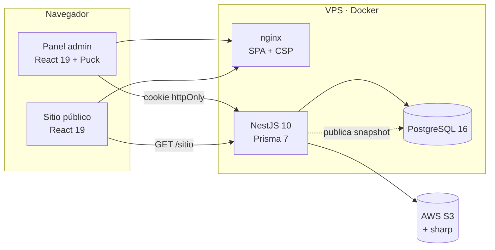

# Portafolio CV

[](https://github.com/Trashercx/cv-portafolio/actions/workflows/ci.yml)
[](https://github.com/Trashercx/cv-portafolio/actions/workflows/codeql.yml)

Sitio de portafolio y CV personal con un panel de administración privado y un editor visual de arrastrar y soltar. Un solo administrador edita perfil, proyectos, certificaciones, logros, skills, redes, tema y fondo; el sitio público muestra siempre la última versión **publicada**, nunca un borrador.

## Qué lo distingue

- **Editor WYSIWYG real**: el lienzo del editor (Puck) renderiza exactamente los mismos componentes que el sitio público, incluido el modo oscuro.
- **Publicación por versiones**: cada publicación guarda una foto completa del sitio (snapshot JSONB). Se puede previsualizar un borrador y revertir a una versión anterior.
- **Tema derivado**: cuatro colores y una fuente generan toda la paleta, con modo claro/oscuro calculado automáticamente.
- **Bloques componibles**: hero, sobre mí, proyectos, certificaciones, logros, skills, galería, contacto y contenedores de columnas anidables.
- **Listo para producción**: cookie httpOnly para la sesión, bloqueo por intentos fallidos, rate limiting, cabeceras de seguridad y CSP, health checks, logs JSON, imágenes Docker sin root y CI con pruebas e2e contra PostgreSQL.

## Arquitectura



Monorepo con npm workspaces:

| Carpeta | Contenido |
|---|---|
| `apps/api` | API NestJS 10, Prisma 7 (`@prisma/adapter-pg`), Passport JWT, AWS S3 + sharp, Terminus, pino |
| `apps/web` | React 19 + Vite, Tailwind CSS v4, shadcn/ui, Puck, TanStack Query, Zustand, React Hook Form + Zod, Vitest |
| `docs/` | Plan funcional (casos de uso, ER), plan técnico (sprints y fases), despliegue, mockups |
| `.github/workflows` | CI (lint, build, unit + e2e), CodeQL, build y push de imágenes a GHCR, deploy por webhook |

## Puesta en marcha local

Requisitos: Node 20 (ver `.nvmrc`), npm 10, Docker.

```bash
npm install                                  # instala ambos workspaces y genera el cliente Prisma
docker compose up -d                         # PostgreSQL 16 en :5433 y Adminer en :8080
cp .env.example apps/api/.env                # completa JWT_SECRET, ADMIN_EMAIL, ADMIN_PASSWORD_SEED, AWS_*
echo "VITE_API_URL=http://localhost:3000" > apps/web/.env.local

cd apps/api && npx prisma migrate deploy     # aplica las migraciones
npx prisma db seed && cd ../..               # crea el administrador único y los catálogos
npm run -w apps/api start:dev                # API en :3000
npm run -w apps/web dev                      # web en :5173
```

Panel: `http://localhost:5173/admin/login` con las credenciales del seed. Sitio público: `http://localhost:5173/`.

Sin credenciales de AWS la API usa un almacenamiento local en `apps/api/uploads` como fallback de desarrollo.

## Comandos útiles

| Acción | API (`apps/api`) | Web (`apps/web`) |
|---|---|---|
| Lint | `npm run lint` | `npm run lint` |
| Build | `npm run build` | `npm run build` |
| Tests unitarios | `npm test` | `npm test` |
| Un solo test | `npx jest src/modules/auth/auth.service.spec.ts` | `npx vitest run src/features/editor/LienzoPuck.test.tsx` |
| Tests e2e | `npm run test:e2e` (requiere Postgres + seed) | — |
| Migración nueva | `npx prisma migrate dev --name <cambio>` | — |

Husky ejecuta commitlint (Conventional Commits en español) y lint-staged en cada commit.

## Despliegue

Las imágenes se publican en GHCR en cada push a `main` y se despliegan con Docker Compose en un VPS (Dokploy o Coolify). Variables, health checks (`/health`, `/health/ready`), CSP, backups y smoke test en [`docs/despliegue.md`](docs/despliegue.md).

## Documentación

- [`docs/plan-portafolio.md`](docs/plan-portafolio.md): stack, casos de uso UC-01 a UC-18 con criterios de aceptación, diagrama ER en 3FN y el **roadmap de profesionalización** (§7) con las fases 7 a 10 propuestas.
- [`docs/plan-tecnico.md`](docs/plan-tecnico.md): estructura del monorepo, historial de sprints y fases, checklist de reglas e índice UC → tarea → subagente.
- [`CLAUDE.md`](CLAUDE.md): guía para trabajar en el repositorio con agentes.

## Estado y roadmap

Completado: Sprint 0 a 8, Fases 3.x, 4.x, 5 (panel unificado del editor) y 6 (fundamentos de producción).

Próximas fases propuestas: visibilidad (metadatos en servidor, sitemap, imágenes responsive, analítica Umami), contenido que vende (experiencia y formación, casos de estudio, testimonios), conversación (formulario de contacto, notas técnicas con RSS, CV en PDF generado) y panel de nivel producto (diff de versiones, publicación programada, passkeys, i18n, observabilidad).
