# Plan de Portafolio CV

**Documento de planificación · v2**
Autor: Oscar · Fecha: 31 ago 2026
Alcance: investigación de stack, casos de uso y modelo de datos para un portafolio/CV con panel de edición visual.

## 1. Resumen y decisiones confirmadas

Sitio público de una sola página (proyectos, certificaciones, logros, redes) respaldado por un panel privado donde tú eres el único usuario. El panel no es solo un CRUD de formularios: incluye un editor visual de arrastrar y soltar para reordenar y componer las secciones del sitio, y un selector de tema para colores y tipografía.

| Parámetro | Decisión |
|---|---|
| Editor de plantillas | Visual, tipo arrastrar y soltar |
| Multimedia | Amazon S3 |
| Autenticación | Administrador único |
| Hosting (aplicación) | VPS propio |

El modelo de datos queda preparado para admitir más de un usuario administrador en el futuro (columna de rol), aunque el alcance actual de autenticación es de un solo administrador sin registro público.

## 2. Stack técnico y librerías complementarias

Base ya definida: React en el frontend, NestJS en el backend, PostgreSQL como base de datos. Debajo, las piezas complementarias necesarias para cubrir edición visual, autenticación, imágenes y despliegue, con la opción recomendada y una alternativa viable en cada capa.

### Editor visual (drag-and-drop)

| Opción | Rol | Justificación |
|---|---|---|
| **Recomendada:** Puck | Motor del editor visual de secciones | Pensado exactamente para este caso: un editor visual embebido dentro de tu propia app React, con un modelo de contenido en JSON (fácil de guardar en Postgres) y componentes que tú mismo restringes, lo que mantiene el resultado sobrio en vez de caótico. |
| Craft.js | Alternativa para un editor a medida | Framework de más bajo nivel para construir editores drag-and-drop propios; da más control pero implica construir más piezas desde cero. |
| GrapesJS | Alternativa "todo incluido" | Builder visual más completo y maduro, pero orientado a HTML libre; cuesta más trabajo mantenerlo dentro de una identidad visual sobria y consistente. |

### Acceso a base de datos (ORM)

| Opción | Rol | Justificación |
|---|---|---|
| **Recomendada:** Prisma | ORM y migraciones sobre PostgreSQL | Esquema declarativo, migraciones versionadas y tipado end-to-end con TypeScript; buen ajuste para un proyecto que crecerá de forma incremental. |
| TypeORM | Alternativa | Integración histórica más directa con NestJS (decoradores de entidades), útil si prefieres el estilo Active Record/Data Mapper nativo del framework. |

### Autenticación del panel

| Opción | Rol | Justificación |
|---|---|---|
| **Recomendada:** @nestjs/passport + passport-jwt | Login del administrador y protección de rutas | Estándar de facto en NestJS; tokens de acceso de corta duración + refresh token, sin endpoint de registro público. Contraseña con bcrypt/argon2. |
| Guards de rol nativos de NestJS | Autorización | Preparan el sistema para distinguir roles si algún día se suma un segundo usuario, sin sobre-construir ahora. |

### Imágenes y archivos multimedia (AWS S3)

| Opción | Rol | Justificación |
|---|---|---|
| **Recomendada:** AWS S3 + `@aws-sdk/client-s3` + multer-s3 | Almacenamiento y subida de imágenes/archivos | Ya definido como proveedor de almacenamiento; el SDK oficial de AWS junto con multer-s3 sube el archivo directo al bucket desde NestJS, sin pasar por disco local. |
| sharp / multer-sharp-s3 | Procesamiento de imágenes antes de subir | A diferencia de un servicio como Cloudinary, S3 no genera miniaturas ni optimiza automáticamente; sharp (o el paquete combinado multer-sharp-s3) genera las variantes necesarias (miniatura, tamaño de galería) antes de guardarlas en el bucket. |
| Amazon CloudFront *(opcional)* | CDN delante del bucket | S3 por sí solo sirve el archivo desde su región; CloudFront agrega una capa de caché cercana al visitante cuando el tráfico lo amerite, sin cambiar el flujo de subida. |

### Interfaz visual y estilos (look sobrio y editable)

| Opción | Rol | Justificación |
|---|---|---|
| **Recomendada:** Tailwind CSS + shadcn/ui | Sistema visual base y componentes del panel | Los componentes se copian a tu proyecto (no son una caja negra), y el tema se controla con variables CSS, lo que mapea directo con el requisito de "poner colores a tu gusto". |
| Mantine | Alternativa | Librería de componentes más completa "de fábrica" (date pickers, notificaciones, etc.), a cambio de menos control fino sobre el detalle visual. |

### Estado, formularios y contenido enriquecido

| Opción | Rol | Justificación |
|---|---|---|
| TanStack Query | Cache de datos del servidor en el frontend | Sincroniza el panel admin con la API sin escribir lógica de cache manual. |
| Zustand | Estado local del editor visual | Estado ligero para la sesión de edición (bloque seleccionado, orden en curso) antes de guardar. |
| React Hook Form + Zod | Formularios y validación | Mismo esquema de validación reutilizable en frontend y como referencia para los DTO de NestJS. |
| Tiptap | Editor de texto enriquecido | Para campos largos como la biografía o la descripción de un proyecto, con salida en JSON/HTML controlado. **Decidido, todavía no implementado** (revisado en Fase 3.1, 2 sept 2026): los campos largos existentes (p. ej. `resumen_bio` del perfil) siguen usando `<Textarea>` plano de shadcn. No asumir que ya está integrado. |

### Pruebas y calidad

| Opción | Rol | Justificación |
|---|---|---|
| Jest + Supertest | Pruebas de backend | Incluidas por defecto en NestJS; cubren servicios y endpoints. |
| Vitest + React Testing Library | Pruebas de frontend | Pruebas de componentes y formularios del panel. |
| Playwright | Pruebas end-to-end | Cubre flujos completos: iniciar sesión, crear un proyecto, publicar cambios. |

### Infraestructura y despliegue (VPS propio)

| Opción | Rol | Justificación |
|---|---|---|
| **Recomendada:** Docker + Dokploy o Coolify | Empaquetado y despliegue en el VPS | Contenerizan frontend, backend y Postgres; la capa Dokploy/Coolify agrega HTTPS automático, variables de entorno y despliegues sin downtime sobre tu propio VPS, sin perder el control de "VPS propio". |
| Nginx + PM2 + Certbot | Alternativa manual | Ruta más tradicional y con más piezas que mantener a mano, útil si prefieres control total sin una capa intermedia. |
| GitHub Actions | Integración continua | Lint, pruebas y build en cada cambio antes de disparar el despliegue. |

### Control de versiones y automatización

| Opción | Rol | Justificación |
|---|---|---|
| **Recomendada:** GitHub + rama por historia + Pull Request | Flujo de versionado | El proyecto nunca se sube completo de una sola vez: cada Pull Request corresponde a una historia/caso de uso acotado, dando puntos de control claros en vez de un commit gigante difícil de revisar o revertir. |
| Husky + lint-staged | Validación antes de cada push (local) | Bloquea el push si el lint, el build o las pruebas fallan, antes de que el problema llegue a GitHub. |
| Conventional Commits | Formato de mensajes de commit | Deja trazabilidad de qué caso de uso (UC-XX) resolvió cada cambio y facilita armar un changelog por sprint. |

## 3. Casos de uso, criterios y parámetros

Dos actores: el **Administrador** (tú, usuario único autenticado) y el **Visitante** (público, sin autenticación). Cada caso de uso indica los campos/parámetros que maneja y el criterio que define cuándo se considera cumplido.

### Actor: Administrador

| ID | Caso de uso | Parámetros / campos clave | Criterio de aceptación |
|---|---|---|---|
| UC-01 | Iniciar sesión | email, contraseña | Con credenciales válidas se emite un token de sesión; tras 3 intentos fallidos se aplica bloqueo temporal. Fase 6: además hay límite de intentos por IP (`429`), y `POST /auth/logout` cierra la sesión borrando la cookie aunque el token ya haya vencido; el panel lo usa al pulsar "Cerrar sesión", al cancelar el aviso de expiración y al expirar la sesión. Octava ronda: `GET /auth/sesion` (protegido por la cookie) devuelve el administrador y la expiración para que el panel rehidrate la sesión al recargar una página en vez de mandar al login. |
| UC-02 | Gestionar perfil personal | nombre completo, título profesional, resumen/bio, foto de perfil, CV en PDF, ubicación | Los cambios guardados aparecen reflejados en la sección "Sobre mí" del sitio publicado. |
| UC-03 | Gestionar proyectos | título, descripción, tecnologías, URLs (demo/repositorio), fechas, estado (en_progreso/finalizado/pausado), imágenes, orden, destacado | Un proyecto creado, editado o eliminado se refleja en la lista de proyectos respetando el orden definido. |
| UC-04 | Gestionar certificaciones | nombre, institución, fecha de emisión/expiración, URL de verificación, logo | Las certificaciones se listan ordenadas por fecha u orden manual, con enlace de verificación funcional. |
| UC-05 | Gestionar logros y reconocimientos | título, descripción, fecha, categoría, referencia | Un logro nuevo aparece en la sección correspondiente sin necesidad de despliegue de código. |
| UC-06 | Gestionar enlaces de redes | plataforma (LinkedIn, GitHub, etc.), URL, orden | Cada enlace abre la red social correcta y respeta el orden e ícono configurado. |
| UC-07 | Editar estructura visual (drag-and-drop) | tipo de sección, orden, visibilidad, configuración del bloque | Al reordenar o mostrar/ocultar una sección en el editor, el cambio se ve igual en la vista previa y, tras publicar, en el sitio en vivo. |
| UC-08 | Personalizar tema visual | color primario/secundario/fondo/texto, tipografía, modo claro/oscuro | Un tema guardado y marcado como activo se aplica de inmediato a la vista previa del sitio. El sitio publicado tiene modo oscuro real (paleta derivada automáticamente de los 4 colores del tema, no solo el `modo` como etiqueta): por defecto sigue la preferencia del sistema del visitante, con un toggle manual que la pisa; `Tema.modo` es el modo base del tema (sus 4 colores se usan tal cual cuando el modo del visitante coincide y se deriva la paleta inversa solo cuando difiere; octava ronda); dentro del editor visual, alternar el modo oscuro del panel cambia el lienzo a la misma paleta oscura que vería un visitante, para que el editor siga siendo fiel a lo publicado. |
| UC-09 | Gestionar biblioteca multimedia | archivo, texto alternativo, tipo | Toda imagen usada en el sitio proviene de la biblioteca y puede reemplazarse sin romper la referencia en proyectos/certificaciones. |
| UC-10 | Previsualizar cambios (borrador) | snapshot de la configuración actual | Es posible ver el sitio con los cambios aplicados antes de que sean visibles públicamente. |
| UC-11 | Publicar o revertir una versión | estado (borrador/publicado), fecha de publicación | Publicar reemplaza la versión visible al público; revertir restaura la última versión publicada anterior. |
| UC-15 | Configurar fondo animado del sitio | tipo (sólido, aurora mesh, malla de puntos con foco, rejilla en perspectiva, red de partículas, ondas fluidas, haces de luz, degradado con grano, campo de estrellas; catálogo de la Fase 7b, que reemplazó a los 8 tipos originales; la Fase 7c suma 11 tipos con tsparticles y shaders WebGL), configuración (velocidad, opacidad; desde la Fase 7b también intensidad e interactivo, opcionales), activo | Un fondo guardado y marcado como activo se aplica de inmediato a la vista previa y, tras publicar, al sitio en vivo; solo un fondo puede estar activo a la vez. |
| UC-16 | Gestionar catálogo de skills | nombre, ícono, orden, visible | Un skill creado, editado, reordenado u ocultado se refleja en el carrusel de skills del sitio publicado tras publicar. |
| UC-17 | Organizar secciones en columnas | distribución (1-1, 1-2, 2-1, 1-1-1), alineación vertical, espaciado, bloques anidados por columna | Un contenedor "Columnas" guardado con bloques distintos en cada columna se ve igual en el lienzo del editor, en la vista previa y, tras publicar, en el sitio en vivo; no admite anidar `hero` ni otro contenedor "Columnas" dentro de sí mismo. |
| UC-18 | Gestionar galería de fotos (bloque) | fotos (referencia a media, título opcional), disposición (carousel/grid), columnas del grid | Un bloque "Galería" guardado con fotos ordenadas se ve igual en el lienzo, la vista previa y el sitio publicado; al hacer click en una foto se abre una vista ampliada (lightbox) navegable entre todas las fotos, sin salir de la página. |

### Actor: Visitante

| ID | Caso de uso | Parámetros / campos clave | Criterio de aceptación |
|---|---|---|---|
| UC-12 | Ver el sitio publicado | última versión publicada | El contenido, orden de secciones y tema mostrados corresponden siempre a la última versión publicada, nunca a un borrador. |
| UC-13 | Ver detalle de un proyecto, certificación o logro | identificador del elemento | Cada proyecto/certificación/logro es accesible individualmente con toda su información e imágenes, desde un modal al hacer click en la home o desde un link directo compartible (`/proyecto/:id`, `/certificacion/:id`, `/logro/:id`). |
| UC-14 | Acceder a redes y descargar el CV | enlaces de redes, archivo de CV | Los enlaces y la descarga del CV funcionan sin requerir autenticación. |

### Extensiones de UC-07, UC-08 y UC-12 — Fase 7, frontend espectacular y editor usable (2026-10-13)

Aprobada por el usuario como siguiente fase, por delante del resto del roadmap (§7). No agrega entidades: amplía `SECCION.configuracion` (JSONB), el catálogo de `TEMA.fuente_principal` y la experiencia del editor. Contrato exacto de campos en `docs/plan-tecnico.md`, Fase 7.

| UC | Extensión | Criterio de aceptación |
|---|---|---|
| UC-07 | Editor sobre Puck 0.23 con rail de plugins (Bloques, Esquema, Campos, Tema, Fondo), interfaz en español, outline arrastrable, scrollbars finas por panel, alto sin desborde, aviso de cambios sin guardar y `Ctrl+S`; usable en tablet y con el rail abajo en móvil | A 768 px el editor permite seleccionar, editar y guardar un bloque sin scroll horizontal; cada panel hace scroll por separado; cerrar la pestaña con cambios pendientes pide confirmación. |
| UC-07 | Nuevo bloque `navegacion` (barra flotante o fija) con enlaces generados desde las secciones visibles con título, enlace al CV, toggle de modo y barra de progreso opcional | En el sitio publicado la barra lleva a cada sección con scroll suave y resalta la activa; en el lienzo del editor se puede seleccionar y configurar; no puede anidarse en columnas. |
| UC-08 | Toggle "Vista previa en oscuro" que cambia solo el lienzo de Puck y la vista previa, sin tocar el modo del panel; edición de temas existentes; vista previa en vivo claro/oscuro dentro del formulario; indicador de contraste WCAG; 12 plantillas; catálogo de 7 fuentes variables cargadas bajo demanda | Con el panel en modo claro, activar el toggle muestra el lienzo en oscuro con la paleta derivada y el panel sigue claro (y viceversa); un tema con contraste texto/fondo < 4.5:1 muestra aviso antes de guardar; cambiar la fuente se ve en el lienzo sin recargar. |
| UC-12 | Opciones visuales nuevas en los bloques: animación de entrada y separadores por bloque, fondos degradado/vidrio; hero con disposición (centrado/dividido/editorial), títulos rotativos, segundo botón, redes, indicador de scroll, efecto de título y decoración de fondo; estadísticas con contador en "Sobre mí"; proyectos en tarjetas/bento/lista con hover elevar/inclinar; skills en marquesina/cuadrícula/nube; contacto destacado; galería con zoom | Cada opción se ve igual en el lienzo, en la vista previa y en el sitio publicado; las animaciones se desactivan con `prefers-reduced-motion`; el sitio no tiene scroll horizontal a 360 px. |

### Extensiones de UC-09, UC-12 y UC-14 — Fase 8, visibilidad (2026-10-14)

Aprobada por el usuario el 2026-10-14 como siguiente fase del roadmap (§7); con ella UC-27 y UC-34 pasan de propuestos a aprobados e implementados. Agrega una sola entidad (`MEDIA_VARIANTE`, ver diagrama ER) y ninguna otra tabla. El contrato técnico exacto (rutas, formas, variables) está en `docs/plan-tecnico.md`, "Fase 8".

| UC | Extensión | Criterio de aceptación |
|---|---|---|
| UC-09 | Variantes responsive de cada imagen de la biblioteca (WebP y AVIF a 640/1024/1600 px, generadas con sharp al subir o reemplazar) y acción "Generar variantes faltantes" para las imágenes anteriores a esta fase | Subir una imagen rasterizada crea sus variantes sin que la subida falle aunque la generación falle; reemplazarla las regenera; eliminarla las borra; la acción de relleno informa procesadas, omitidas y errores. |
| UC-12 | Las imágenes del sitio se sirven con `<picture>`/`srcset` (AVIF → WebP → original) y `sizes` por contexto; la imagen de fondo del hero con `image-set()` | En móvil el navegador descarga la variante de 640 px; sin variantes (snapshots anteriores a la fase) se muestra el original; las imágenes declaran `width`/`height` y no desplazan el contenido al cargar. |
| UC-14 | Los enlaces a redes y al CV registran los eventos `clic_red` y `descargar_cv` en la analítica, si está configurada | Sin analítica configurada los enlaces funcionan igual y el sitio no carga ningún script externo. |
| UC-27 | Página `/admin/metricas` con periodo 7/30/90 días, entrada "Métricas" en el panel | Ver fila UC-27 más abajo; la página indica el motivo (`no_configurado`, `sin_respuesta`, `no_autorizado`) cuando la analítica no está disponible, sin romper el resto del panel. |
| UC-34 | Metadatos inyectados por nginx (SSI) desde el API para `/`, `/proyecto/:id`, `/certificacion/:id` y `/logro/:id`; `sitemap.xml` y `robots.txt` generados desde la versión publicada; Lighthouse CI con presupuestos | `curl` sin JavaScript a cualquier URL pública devuelve `<title>`, `description`, Open Graph y Twitter card correctos; `/sitemap.xml` lista la home y los detalles publicados; el workflow de Lighthouse falla si rendimiento < 90, accesibilidad < 95, buenas prácticas < 90 o SEO < 90 en móvil. |

### Extensión de UC-15 — Fase 7b, fondos interactivos y vista previa (2026-10-14)

Pedida por el usuario al cerrar la Fase 8 como continuación del trabajo de frontend. No agrega entidades: renombra los tipos de `FONDO_SITIO.tipo` (migración de datos) y amplía `FONDO_SITIO.configuracion` (JSONB) con dos campos opcionales. Contrato técnico en `docs/plan-tecnico.md`, "Fase 7b".

| UC | Extensión | Criterio de aceptación |
|---|---|---|
| UC-15 | Catálogo nuevo de fondos (sólido, aurora mesh, malla de puntos con foco, rejilla en perspectiva, red de partículas, ondas fluidas, haces de luz, degradado con grano, campo de estrellas) que reemplaza a los 8 anteriores; configuración con `intensidad` e `interactivo` además de `velocidad` y `opacidad` | Los fondos guardados con tipos antiguos siguen funcionando (migrados y mapeados en los snapshots publicados); con `prefers-reduced-motion` ningún fondo se mueve ni reacciona; en móvil sin puntero no hay efectos de puntero; la home sigue cumpliendo el presupuesto de Lighthouse. |
| UC-15 | El panel "Fondo" del editor muestra una galería con miniatura en vivo de cada fondo, activa con un clic y permite ajustar velocidad, opacidad, intensidad e interactividad con vista previa grande y reflejo inmediato en el lienzo | Cada tarjeta muestra su fondo animado con el tema activo; al ajustar, el lienzo cambia antes de guardar y vuelve al fondo guardado al cancelar; guardar emite un único `PATCH`. |

### Extensiones de UC-07, UC-12 y UC-15 — Fase 7c, más fondos y contornos opcionales (2026-10-14)

Pedida por el usuario tras ver la Fase 7b en producción. Sin entidades nuevas: amplía el catálogo de `FONDO_SITIO.tipo` (20 tipos) y `SECCION.configuracion` (campo base `borde_bloque`). Contrato en `docs/plan-tecnico.md`, "Fase 7c".

| UC | Extensión | Criterio de aceptación |
|---|---|---|
| UC-15 | 11 fondos nuevos con librerías ligeras (constelación, nieve, luciérnagas, burbujas, estrellas fugaces, confeti suave con tsparticles; aurora boreal, seda, plasma, líquido, ondas dither con shaders WebGL) | Cada uno se previsualiza animado en la galería, usa los colores del tema, respeta `prefers-reduced-motion`, no crece el bundle inicial y la home sigue cumpliendo el presupuesto de Lighthouse. |
| UC-07 | Toggle "Vista limpia" en el editor que oculta los recuadros y overlays de Puck y el borde punteado de las secciones ocultas | Con la vista limpia el lienzo se ve como el sitio publicado; al desactivarla se vuelve a poder seleccionar bloques. |
| UC-12 | Campo "Borde del bloque" (ninguno/sutil/marcado) que gobierna el borde del contenedor y de todas las tarjetas, chips y recuadros del bloque | Con "ninguno" ningún elemento del bloque muestra borde en lienzo, vista previa ni sitio; los snapshots anteriores conservan el aspecto actual (`sutil`). |

### Extensión de UC-09 y caso de uso nuevo UC-35 — Fase 7d, biblioteca usable e insignias (2026-10-14)

Pedida por el usuario tras cerrar la Fase 7c. Agrega la entidad `INSIGNIA` (ver diagrama ER) y un tipo de bloque `insignias`. Contrato técnico en `docs/plan-tecnico.md`, "Fase 7d".

| UC | Extensión / caso | Criterio de aceptación |
|---|---|---|
| UC-09 | Biblioteca con arrastrar y soltar y subida en lote con progreso, búsqueda, orden, vista cuadrícula/lista, selección múltiple con borrado en lote, indicador "en uso" (perfil, CV, proyecto, certificación, hero, galería, insignia), copiar URL y texto alternativo en línea | Se pueden soltar varias imágenes a la vez y ver el progreso de cada una; un archivo en uso no se borra en lote y el diálogo indica dónde se usa; la búsqueda y los filtros se conservan en la URL. |
| UC-35 | Gestionar insignias (badges) importadas | enlace público, código de embed o archivo del badge; nombre, emisor, descripción, fechas, habilidades, URL de verificación, imagen, orden, visible | Pegar un enlace de Credly, un enlace de verificación Open Badges o un código de embed muestra una vista previa con los datos y la imagen original en alta resolución; al guardar, la imagen queda en la biblioteca con variantes y la insignia aparece en el bloque "Insignias" del sitio con animación al pasar el puntero y enlace de verificación; si el proveedor no se reconoce, se importa la imagen y el título de la página y los demás datos se completan a mano. |

### Extensiones de UC-04, UC-09 y UC-35 — Fase 7e, vencimiento opcional, más proveedores y carpetas (2026-10-14)

Pedida por el usuario tras probar la Fase 7d en producción. Agrega la entidad `CARPETA_MEDIA` (ver diagrama ER) y `MEDIA.carpeta_id`. Contrato en `docs/plan-tecnico.md`, "Fase 7e".

| UC | Extensión | Criterio de aceptación |
|---|---|---|
| UC-04, UC-35 | Casilla "No expira" en certificaciones e insignias; "Sin vencimiento" en los bloques | Una credencial sin fecha de expiración se guarda y se muestra como "Sin vencimiento"; al desmarcar la casilla la fecha vuelve a ser obligatoria y posterior a la emisión. |
| UC-35 | Proveedores ampliables: registro visible en el diálogo ("Proveedores reconocidos"), extractor de Anthropic/Skilljar automático, DataCamp por archivo (su web bloquea la lectura automática) y certificados en PDF convertidos a imagen en el navegador | Pegar un enlace `verify.skilljar.com` rellena nombre, emisor, fechas e imagen; pegar un enlace de DataCamp reconoce el proveedor y guía a subir el PDF o la imagen; un PDF subido se convierte en PNG de alta resolución y se importa como insignia. |
| UC-09 | Carpetas planas en la biblioteca (crear, renombrar, reordenar, eliminar), filtro por carpeta en la URL y en el selector de los formularios, subida a la carpeta activa, mover archivos por menú o arrastrándolos | Eliminar una carpeta no borra archivos (quedan "Sin carpeta"); los nombres son únicos por administrador sin distinguir mayúsculas; la clave de S3 no cambia al mover. |

### Extensión de UC-01 — Fase 7f, pantalla de inicio de sesión (2026-10-14)

Solo frontend. Contrato en `docs/plan-tecnico.md`, "Fase 7f".

| UC | Extensión | Criterio de aceptación |
|---|---|---|
| UC-01 | Pantalla de login con panel de marca (fondo y tema del sitio publicado, nombre y título del perfil), contraseña con mostrar/ocultar y aviso de Bloq Mayús, recordar email, mensajes claros por tipo de error (credenciales, bloqueo, demasiados intentos, red, sesión expirada) y animación de entrada | En móvil cabe en una columna sin scroll horizontal; tras un error el foco vuelve a la contraseña; la contraseña nunca se guarda en el navegador; con `prefers-reduced-motion` no hay animación. |

### Extensión de UC-09 y UC-35 — Fase 7g, formatos de imagen de móvil (2026-10-14)

Web, API menor y CSP. Contrato en `docs/plan-tecnico.md`, "Fase 7g".

| UC | Extensión | Criterio de aceptación |
|---|---|---|
| UC-09 | La biblioteca y los campos de imagen aceptan las fotos tal como salen del teléfono: HEIC/HEIF (iPhone) además de JPG, PNG, WebP, AVIF, GIF y SVG; el formato se decide por el contenido y la extensión, no por el tipo MIME que declare el sistema | Un `.heic` elegido en Windows (tipo MIME vacío) o en iOS se convierte a JPG en el navegador, se sube y queda con variantes como cualquier JPG; un archivo no admitido se rechaza con un mensaje que enumera los formatos válidos; el API responde 400 explicativo si recibe un HEIC sin convertir. |
| UC-35 | La pestaña "Subir archivo" de insignias acepta también JPG, WebP y HEIC (convertido a JPG) | Importar una captura HEIC produce la vista previa saneada igual que un PNG. |

### Extensión de UC-09 y UC-35 — Fase 7h, medallas y nombres legibles (2026-10-15)

Web y API menor, sin esquema. Contrato en `docs/plan-tecnico.md`, "Fase 7h".

| UC | Extensión | Criterio de aceptación |
|---|---|---|
| UC-09 | El archivo se guarda en S3 con el nombre con el que se subió (saneado: sin tildes ni espacios, con la extensión real) y la biblioteca muestra ese nombre; la cola de subida se limpia sola y no anuncia conversiones internas de formato | Subir "Certificado AWS.pdf" deja la clave `<carpeta>/<id>/Certificado-AWS.pdf` y la tarjeta muestra "Certificado-AWS.pdf"; dos archivos con el mismo nombre no se pisan; al terminar, el archivo desaparece de la cola sin pulsar nada; un fallo se queda con "Reintentar" y "Descartar"; ningún texto menciona la conversión a JPG. Los archivos anteriores conservan su clave y muestran su texto alternativo si lo tienen. |
| UC-35 | El bloque "Insignias" se presenta por defecto como medallas: solo la imagen oficial, con movimiento en reposo (flotar, balanceo o destello), marco (halo, aro, cinta o ninguno) y el nombre al pasar el cursor, siempre o nunca; toda la medalla es un botón que abre la verificación. Todo se configura desde el editor visual; la presentación en tarjetas de la Fase 7d sigue disponible | Las medallas no muestran emisor, fechas ni habilidades; hacer clic en una abre su URL de verificación en otra pestaña; con movimiento reducido quedan quietas; el panel de Puck solo muestra las opciones de la presentación elegida. |

### Casos de uso propuestos — roadmap de profesionalización (2026-10-13, pendientes de aprobación)

Los UC-19 a UC-34 nacen de la propuesta de la Sección 7 (roadmap). Se listan aquí para que el índice de casos de uso siga siendo la única fuente de verdad. **Solo UC-27 y UC-34 están aprobados e implementados** (Fase 8, 2026-10-14) y UC-35 (insignias, Fase 7d, definido en la sección anterior); el resto sigue pendiente: cada fase del roadmap se aprueba por separado y recién entonces se agregan sus entidades al diagrama ER (vía `db-schema`) y se codifica. La Fase 6 (fundamentos de producción) no agrega casos de uso: refuerza UC-01 (cierre de sesión real, límite de intentos por IP) y UC-12/13 (metadatos SEO, accesibilidad, rendimiento).

#### Actor: Administrador (propuestos)

| ID | Caso de uso | Parámetros / campos clave | Criterio de aceptación |
|---|---|---|---|
| UC-19 | Gestionar experiencia laboral y formación | experiencia: empresa, cargo, descripción, fecha inicio/fin o "actual", ubicación, modalidad (presencial/remoto/híbrido), tecnologías, orden; formación: institución, título, área, fecha inicio/fin, descripción | El sitio publicado muestra un bloque "Trayectoria" en línea de tiempo (experiencia y formación intercaladas o en pestañas), ordenado por fecha descendente; un puesto "actual" se muestra sin fecha de fin y con duración calculada. |
| UC-20 | Redactar casos de estudio de proyectos | por proyecto: slug, contexto/problema, mi rol, proceso, solución, resultados (lista de métricas etiqueta + valor + comparación opcional), aprendizajes, imágenes por sección; texto enriquecido | Un proyecto con caso de estudio tiene página propia `/proyecto/:slug` con las secciones en ese orden y las métricas destacadas al inicio; un proyecto sin caso de estudio conserva el modal actual (UC-13). El texto enriquecido se edita con Tiptap y se guarda como JSON de ProseMirror validado. |
| UC-21 | Publicar notas técnicas (blog) | título, slug único, resumen, contenido enriquecido, imagen de portada, etiquetas, estado (borrador/publicada), fecha de publicación, tiempo de lectura calculado | Solo las notas publicadas aparecen en `/notas` y `/notas/:slug`; cada nota lleva sus propios metadatos SEO; existe un feed RSS en `/notas.xml`. Las notas **no** pasan por el snapshot del sitio: tienen su propio ciclo borrador/publicada. |
| UC-22 | Gestionar bandeja de mensajes de contacto | mensaje (nombre, email, asunto, cuerpo, fecha, IP enmascarada), estado (nuevo/leído/archivado), nota interna | El panel lista los mensajes recibidos con filtros por estado; marcar leído/archivar persiste; "Responder" abre `mailto:` con asunto citado; el admin recibe un email por cada mensaje válido. |
| UC-23 | Gestionar testimonios y recomendaciones | autor, cargo, empresa, texto, foto o logo, enlace (LinkedIn), orden, visible | Un testimonio visible aparece en el bloque "Testimonios" del sitio publicado respetando el orden; los ocultos no viajan en el snapshot. |
| UC-24 | Declarar disponibilidad y "qué estoy haciendo ahora" | estado (disponible / abierto a propuestas / no disponible), mensaje corto, lista "ahora" (texto + enlace opcional), fecha de actualización automática | El hero muestra un distintivo de disponibilidad con el color correspondiente; el bloque "Ahora" lista los ítems con la fecha "actualizado el …". |
| UC-25 | Comparar versiones y programar publicación | dos versiones a comparar; fecha/hora de publicación programada | El historial muestra, entre dos versiones, qué secciones/entidades cambiaron (diff legible por humanos, no JSON crudo); una versión programada se publica sola a la hora indicada en la zona horaria configurada, y puede cancelarse antes. Revertir sigue siendo UC-11. |
| UC-26 | Proteger la cuenta de administrador | contraseña actual/nueva; passkeys (WebAuthn) registradas (nombre, fecha, último uso); sesiones activas; registro de accesos (fecha, IP enmascarada, agente, resultado) | Se puede cambiar la contraseña y registrar al menos una passkey; iniciar sesión con passkey no pide contraseña; "cerrar todas las sesiones" invalida los tokens emitidos; cada login (exitoso o fallido), publicación y cambio de credenciales queda en el registro de auditoría. |
| UC-27 | Ver métricas del sitio | periodo (7/30/90 días); visitas, visitantes únicos, páginas más vistas, referidos, descargas de CV, clics a redes, países | El panel muestra las métricas del periodo sin cookies ni consentimiento (analítica propia, Umami autoalojado); si el servicio de analítica no responde, el panel lo indica sin romper el resto. |
| UC-28 | Traducir el contenido (ES/EN) | idioma por defecto; por entidad, los campos traducibles (títulos, descripciones, biografía, textos de bloques) con su valor por idioma | El editor muestra qué campos faltan por traducir; el snapshot publicado contiene ambos idiomas; un campo sin traducción cae al idioma por defecto, nunca queda vacío. |
| UC-29 | Generar el CV en PDF desde los datos | plantilla (clásica/moderna), secciones incluidas, idioma, nombre de archivo | Al publicar se regenera un PDF del CV coherente con el sitio (perfil, experiencia, formación, proyectos destacados, certificaciones, skills); el admin puede seguir subiendo un PDF propio que tiene prioridad (UC-02); el mismo dato se exporta en formato JSON Resume. |

#### Actor: Visitante (propuestos)

| ID | Caso de uso | Parámetros / campos clave | Criterio de aceptación |
|---|---|---|---|
| UC-30 | Enviar un mensaje de contacto | nombre, email, asunto, mensaje; campo señuelo (honeypot) oculto; desafío invisible (Cloudflare Turnstile); tiempo mínimo de llenado | Un mensaje válido muestra confirmación y llega a la bandeja (UC-22); un envío con el señuelo lleno, un desafío inválido, un llenado demasiado rápido o más de N envíos por IP y hora se rechaza sin pista útil para bots; el formulario funciona con teclado y lector de pantalla. |
| UC-31 | Leer notas técnicas y suscribirse por RSS | slug, etiqueta, feed | Las notas publicadas se leen en `/notas/:slug` con título, fecha, tiempo de lectura, etiquetas y navegación anterior/siguiente; el feed RSS valida y actualiza al publicar. |
| UC-32 | Ver casos de estudio y trayectoria | slug del proyecto | La página del caso de estudio es legible en móvil, con tabla de contenidos y métricas al inicio; la trayectoria se lee como línea de tiempo con fechas y duraciones. |
| UC-33 | Cambiar el idioma del sitio | idioma (ES/EN), preferencia recordada | El selector cambia todo el contenido traducido sin recargar; la preferencia se recuerda; las URLs públicas aceptan `?lang=` o prefijo `/en/` para compartir. |
| UC-34 | Compartir enlaces con vista previa correcta y encontrar el sitio en buscadores | URL pública | Al compartir cualquier URL pública en LinkedIn, WhatsApp o X aparece título, descripción e imagen correctos **sin ejecutar JavaScript** (metadatos inyectados en el servidor); existen `sitemap.xml` y `robots.txt` generados desde el contenido publicado; Lighthouse ≥ 90 en rendimiento, accesibilidad, buenas prácticas y SEO en móvil. |

## 4. Modelo de datos y diagrama ER

El esquema separa contenido (proyectos, certificaciones, logros), catálogos reutilizables (tecnologías, plataformas de red social), archivos (tabla de medios) y configuración visual (secciones, tema, versiones publicadas), evitando campos repetidos o cadenas de texto que deberían ser relaciones.

```mermaid
erDiagram
    USUARIO_ADMIN {
        uuid id PK
        string email UK
        string password_hash
        string nombre
        string rol
        int intentos_fallidos
        timestamp bloqueado_hasta
        timestamp created_at
    }
    PERFIL {
        uuid id PK
        uuid usuario_admin_id FK
        string nombre_completo
        string titulo_profesional
        text resumen_bio
        uuid imagen_perfil_id FK
        uuid cv_media_id FK
        string ubicacion
        timestamp updated_at
    }
    MEDIA {
        uuid id PK
        uuid usuario_admin_id FK
        uuid carpeta_id FK
        string url
        string s3_key
        string tipo
        int ancho
        int alto
        string alt_text
        timestamp created_at
    }
    CARPETA_MEDIA {
        uuid id PK
        uuid usuario_admin_id FK
        string nombre
        int orden
        timestamp created_at
    }
    MEDIA_VARIANTE {
        uuid id PK
        uuid media_id FK
        string formato
        int ancho
        int alto
        string url
        string s3_key
        int bytes
        timestamp created_at
    }
    PROYECTO {
        uuid id PK
        uuid usuario_admin_id FK
        string titulo
        text descripcion
        string url_demo
        string url_repositorio
        date fecha_inicio
        date fecha_fin
        string estado
        boolean destacado
        int orden
    }
    PROYECTO_IMAGEN {
        uuid proyecto_id FK
        uuid media_id FK
        int orden
    }
    TECNOLOGIA {
        uuid id PK
        string nombre UK
    }
    PROYECTO_TECNOLOGIA {
        uuid proyecto_id FK
        uuid tecnologia_id FK
    }
    CERTIFICACION {
        uuid id PK
        uuid usuario_admin_id FK
        string nombre
        string institucion
        date fecha_emision
        date fecha_expiracion
        string url_verificacion
        string credencial_id
        uuid logo_media_id FK
        int orden
    }
    LOGRO {
        uuid id PK
        uuid usuario_admin_id FK
        string titulo
        text descripcion
        date fecha
        string categoria
        string url_referencia
        int orden
    }
    PLATAFORMA_RED {
        uuid id PK
        string nombre UK
        string icono_defecto
    }
    RED_SOCIAL {
        uuid id PK
        uuid usuario_admin_id FK
        uuid plataforma_id FK
        string url
        int orden
    }
    SECCION {
        uuid id PK
        uuid usuario_admin_id FK
        string tipo_seccion
        string titulo_visible
        int orden
        boolean visible
        jsonb configuracion
    }
    TEMA {
        uuid id PK
        uuid usuario_admin_id FK
        string nombre
        string color_primario
        string color_secundario
        string color_fondo
        string color_texto
        string fuente_principal
        string modo
        boolean activo
    }
    SKILL {
        uuid id PK
        uuid usuario_admin_id FK
        string nombre
        string icono
        int orden
        boolean visible
    }
    FONDO_SITIO {
        uuid id PK
        uuid usuario_admin_id FK
        string tipo
        jsonb configuracion
        boolean activo
    }
    VERSION_SITIO {
        uuid id PK
        uuid usuario_admin_id FK
        string estado
        jsonb snapshot
        timestamp publicado_en
    }

    INSIGNIA {
        uuid id PK
        uuid usuario_admin_id FK
        string nombre
        string emisor
        text descripcion
        string proveedor
        string id_externo
        string url_verificacion
        string url_origen
        uuid imagen_media_id FK
        date fecha_emision
        date fecha_expiracion
        string[] habilidades
        int orden
        boolean visible
        timestamp created_at
        timestamp updated_at
    }

    USUARIO_ADMIN ||--o| PERFIL : tiene
    USUARIO_ADMIN ||--o{ MEDIA : sube
    USUARIO_ADMIN ||--o{ CARPETA_MEDIA : organiza
    CARPETA_MEDIA ||--o{ MEDIA : contiene
    USUARIO_ADMIN ||--o{ PROYECTO : gestiona
    USUARIO_ADMIN ||--o{ CERTIFICACION : gestiona
    USUARIO_ADMIN ||--o{ INSIGNIA : gestiona
    USUARIO_ADMIN ||--o{ LOGRO : gestiona
    USUARIO_ADMIN ||--o{ RED_SOCIAL : gestiona
    USUARIO_ADMIN ||--o{ SECCION : configura
    USUARIO_ADMIN ||--o{ TEMA : define
    USUARIO_ADMIN ||--o{ SKILL : gestiona
    USUARIO_ADMIN ||--o{ FONDO_SITIO : define
    USUARIO_ADMIN ||--o{ VERSION_SITIO : publica
    PERFIL }o--o| MEDIA : "foto de perfil"
    PERFIL }o--o| MEDIA : "cv en pdf"
    PROYECTO ||--o{ PROYECTO_IMAGEN : contiene
    MEDIA ||--o{ PROYECTO_IMAGEN : "usado en"
    MEDIA ||--o{ MEDIA_VARIANTE : "derivadas"
    MEDIA ||--o{ INSIGNIA : imagen
    PROYECTO ||--o{ PROYECTO_TECNOLOGIA : usa
    TECNOLOGIA ||--o{ PROYECTO_TECNOLOGIA : "aplicada en"
    CERTIFICACION }o--o| MEDIA : logo
    PLATAFORMA_RED ||--o{ RED_SOCIAL : clasifica
```

Diecinueve entidades: el administrador es el dueño de todo el contenido; `MEDIA`, `TECNOLOGIA` y `PLATAFORMA_RED` son catálogos compartidos en vez de campos de texto libre repetidos; `SECCION`, `TEMA`, `FONDO_SITIO` y `VERSION_SITIO` sostienen el editor visual y la publicación por versiones. `SKILL` sigue el mismo patrón que `LOGRO`: contenido propio del administrador (no un catálogo compartido) — a diferencia de `TECNOLOGIA`, que solo clasifica proyectos, `SKILL` es lo que se muestra en el carrusel de habilidades del sitio público, así que no tendría sentido reutilizar aquel catálogo para este propósito distinto. `FONDO_SITIO` sigue el mismo patrón de "configuración visual exclusiva" que `TEMA`, pero es deliberadamente independiente de él: `TEMA` solo maneja color y tipografía, `FONDO_SITIO` maneja el fondo animado del landing. `CARPETA_MEDIA` organiza la biblioteca del panel en carpetas planas (Fase 7e, UC-09); no cambia la clave de S3 y al borrar una carpeta sus archivos quedan sin carpeta (`ON DELETE SET NULL`); nombre único por administrador sin distinguir mayúsculas.

`INSIGNIA` guarda badges importados de Credly/Open Badges u otros (Fase 7d, UC-35); es independiente de `CERTIFICACION` porque la insignia es la imagen oficial emitida por un tercero con proveedor e id externo, mientras que la certificación es un registro propio con logo de institución; `habilidades` es un array nativo de Postgres (no JSONB) porque son etiquetas planas sin estructura.

`MEDIA_VARIANTE` guarda las variantes responsive (WebP/AVIF por ancho) derivadas de cada `MEDIA` (Fase 8, UC-34), en tabla propia y no como JSON dentro de `MEDIA`, para respetar 3FN y poder borrarlas en cascada.

`USUARIO_ADMIN.intentos_fallidos` (int, default 0) y `USUARIO_ADMIN.bloqueado_hasta` (timestamp, nullable) se agregan porque el criterio de aceptación de UC-01 exige bloqueo temporal tras 3 intentos fallidos de login, y el esquema original no tenía dónde contar esos intentos ni hasta cuándo dura el bloqueo.

### Por qué queda normalizado (hasta 3FN)

- **1FN:** todo atributo es atómico: no hay campos como "tecnologias: React, NestJS" en una sola celda; eso vive en `PROYECTO_TECNOLOGIA`, una fila por tecnología usada.
- **2FN:** en las tablas de unión (`PROYECTO_TECNOLOGIA`, `PROYECTO_IMAGEN`) los atributos no clave dependen de la combinación completa de la llave compuesta, no de una sola mitad.
- **3FN:** no hay dependencias transitivas: el nombre de una plataforma de red social o de una tecnología vive una sola vez en su catálogo (`PLATAFORMA_RED`, `TECNOLOGIA`), no repetido en cada fila que la referencia.

Tres excepciones deliberadas, todas justificadas por el propio requisito de edición visual: `SECCION.configuracion`, `VERSION_SITIO.snapshot` y `FONDO_SITIO.configuracion` usan `JSONB` porque el contenido de un bloque del editor (o una foto completa del sitio para poder revertirla, o los parámetros de un fondo animado) tiene forma variable por diseño; forzarlo a columnas fijas obligaría a rediseñar el esquema cada vez que agregues un tipo de bloque o de fondo nuevo. `FONDO_SITIO.configuracion` en particular guarda solo `velocidad` y `opacidad`, los dos parámetros que comparten los cinco tipos de fondo (sólido, degradado animado, aurora animada, partículas, cuadrícula animada); columnas fijas por tipo obligarían a alterar el esquema cada vez que se agregue un tipo de fondo nuevo.

`SECCION.configuracion` como `JSONB` tiene además una segunda ventaja que se explota recién en UC-17 (layouts en columnas, Fase 3.3 del rediseño del editor): un bloque `columnas` es una `SECCION` más, con `tipo_seccion = 'columnas'`, cuya `configuracion` guarda no solo `distribucion`/`alineacion_vertical`/`espaciado` sino también los bloques anidados de cada columna, con la misma forma que tendría cada uno como fila propia (mismo DTO por tipo, validado igual). **Decisión explícita: no se agrega ninguna entidad ni columna nueva para esto** — la alternativa evaluada (una auto-relación `SECCION.seccion_padre_id`) se descartó porque exige migración, cambia la lógica de listar/reordenar secciones, y su único beneficio real (un id de fila estable por cada bloque anidado) no compensa la complejidad para un proyecto de un solo administrador sin enlaces directos a una sección individual. Consecuencia aceptada de esta decisión: anidar una sección ya existente dentro de un contenedor "Columnas" borra su fila y su contenido pasa a vivir en el JSON del contenedor; sacarla de nuevo a nivel superior crea una fila nueva (no recupera el `id` original). Un contenedor "Columnas" no admite anidar `hero` (la portada ocupa todo el ancho por diseño) ni otro contenedor "Columnas" (evita anidamiento sin límite en el resolver de media, el snapshot y el renderer) — restricción de un solo nivel, reforzada en el DTO de configuración, no solo en la UI.

El mismo criterio de `SECCION.configuracion` como `JSONB` cubre UC-18 (bloque "Galería", Fase 4.5 del rediseño): `tipo_seccion = 'galeria'` guarda un array de fotos (`media_id` + título opcional) más `disposicion`/`columnas_grid`. **Decisión explícita: no se usa el patrón `PROYECTO_IMAGEN`** (relación N:N con su propia tabla) para esto — a diferencia de las imágenes de un proyecto, que son datos propios de la entidad `PROYECTO` con sentido fuera del editor visual (se listan también en `GET /admin/proyectos/:id`), las fotos de una galería son una forma variable propia de un bloque del editor, exactamente el tipo de caso que la excepción JSONB ya cubre — igual que los bloques anidados de `columnas`. Sin migración de tabla.

> **Regla de negocio a aplicar en la aplicación (no solo en el esquema):** solo un registro de `TEMA` por administrador puede tener `activo = true` a la vez; conviene reforzarlo con un índice único parcial en PostgreSQL además de la validación en NestJS.

> **Regla de negocio a aplicar en la aplicación (no solo en el esquema):** solo un registro de `FONDO_SITIO` por administrador puede tener `activo = true` a la vez; mismo mecanismo que `TEMA` (índice único parcial en PostgreSQL + validación en NestJS).

> **Regla de negocio a aplicar en la aplicación (no solo en el esquema):** `SKILL.nombre` debe ser único por administrador sin distinguir mayúsculas/minúsculas — no pueden coexistir, por ejemplo, "Java" y "java" en el mismo carrusel de skills (Fase 3.2 del rediseño del editor, hallazgo de "skills duplicados"). Un `@@unique` declarativo de Prisma no sirve aquí porque compara de forma sensible a mayúsculas/minúsculas; se refuerza con un índice único funcional en PostgreSQL sobre `(usuario_admin_id, lower(nombre))`, mismo mecanismo manual que `tema_admin_activo_unico` y `fondo_sitio_admin_activo_unico`, más la validación correspondiente en SkillsService.

## 5. Despliegue y operación en el VPS

Consideraciones para que el VPS propio quede simple de mantener siendo tú el único administrador del sistema.

- **Contenedores:** un contenedor para el frontend, uno para la API NestJS y uno para PostgreSQL (o Postgres administrado aparte con backups automáticos), orquestados con Docker Compose.
- **Capa de despliegue:** Dokploy o Coolify sobre el VPS para HTTPS automático, variables de entorno y despliegues disparados por cada push a la rama principal.
- **Respaldo de base de datos:** tarea programada de `pg_dump` con copia en un bucket S3 (el mismo usado para medios u otro dedicado a backups).
- **Operación (Fase 6):** la API expone `GET /health` (liveness, sin base de datos) y `GET /health/ready` (readiness con `SELECT 1`), sin autenticación y sin detalle del error en la respuesta; las imágenes Docker llevan `HEALTHCHECK` y Compose espera a que la API esté sana antes de levantar el frontend. La API corre detrás del proxy con `TRUST_PROXY=true` y su puerto solo se publica en loopback.
- **Variables sensibles:** credenciales de AWS (idealmente un usuario/rol IAM con permisos acotados solo al bucket), secreto JWT y credenciales de Postgres fuera del repositorio, gestionadas como variables de entorno del VPS.

## 6. Control de versiones y flujo de trabajo (Git + Scrum)

El proyecto se sube a GitHub de forma escalonada, nunca completo de una sola vez, y avanza en sprints cortos con un punto de control tuyo al final de cada uno. Un subagente dedicado, `release-manager`, decide cuándo un cambio está listo para commitear o pushear, y arma el resumen de cierre de cada sprint.

### Estrategia de ramas

- `main` siempre queda desplegable: nunca recibe push directo, solo cambios vía Pull Request.
- Cada historia (normalmente, un caso de uso de la sección 3) vive en su propia rama, por ejemplo `feature/uc-03-proyectos`.
- Cerrar una historia = abrir un Pull Request hacia `main`, aunque trabajes solo: da un punto de revisión concreto en vez de perder el cambio en una rama larga.
- Al cerrar un sprint completo se etiqueta la versión sobre `main` (`v0.1.0`, `v0.2.0`, …).

### Niveles de criticidad (qué tan seguido se empuja)

| Nivel | Ejemplos | Cómo se maneja |
|---|---|---|
| Bajo | Ajustes de estilos, textos, configuración menor | Se acumula en commits pequeños dentro de la rama de la historia en curso; no requiere Pull Request inmediato. |
| Moderado | Un caso de uso completo y probado (ej. UC-04 Certificaciones) | Se empuja en su propia rama y se abre Pull Request hacia `main`; marca el cierre de una historia dentro del sprint. |
| Crítico | Cambios al esquema de datos, autenticación, o algo que toca varios módulos a la vez | Nunca merge directo: exige revisión de `code-reviewer`, pruebas completas y tu aprobación explícita antes de mergear. |

### Validación antes de cada push

Antes de que un cambio salga de tu máquina hacia GitHub, build, lint y pruebas deben pasar en local (vía Husky) y se repiten de forma independiente en GitHub Actions al abrir el Pull Request. `release-manager` corre esta verificación y bloquea el push si algo falla, en vez de descubrir el problema después de que ya está en el repositorio.

Si en algún momento corres dos subagentes de código a la vez (por ejemplo `backend-nestjs` y `frontend-react` trabajando en paralelo), agrégales `isolation: worktree` en su frontmatter: cada uno trabaja sobre su propia copia temporal del repositorio en vez de sobre los mismos archivos, así sus cambios no se superponen antes de integrarlos.

### Sprints sugeridos

| Sprint | Alcance | Punto de control (tu visto bueno) |
|---|---|---|
| 0 — Cimientos | Monorepo, esquema Prisma inicial, autenticación (UC-01) | Puedes iniciar sesión como administrador en local. |
| 1 — Contenido base (API) | UC-02 a UC-06: perfil, proyectos, certificaciones, logros, redes, sin interfaz aún | La API responde y está probada (Jest/Supertest). |
| 2 — Panel de administración | Pantallas CRUD para todo lo del sprint 1 | Puedes cargar tu CV real desde el panel. |
| 3 — Editor visual y tema | UC-07 a UC-09: secciones drag-and-drop, colores/tipografía, biblioteca de medios en S3 | Puedes reordenar secciones y cambiar el tema desde el panel. |
| 4 — Publicación y sitio público | UC-10 a UC-14: borrador/publicar y sitio visible | El sitio público muestra tu información real, con enlaces y CV descargable. |
| 5 — Despliegue | Docker + Dokploy/Coolify en el VPS, backups a S3 | El sitio es accesible desde tu dominio. |

Cada sprint cierra con un resumen de `release-manager`: qué UC quedaron terminados y probados, qué quedó pendiente, y qué decisión necesita tu aprobación antes de arrancar el siguiente. El sprint no avanza hasta que des el visto bueno o pidas ajustes.

## 7. Roadmap de profesionalización (propuesta del 2026-10-13)

Los "siguientes pasos" originales de esta sección (repositorio, Husky, catálogos, endpoints, sprints 0–8) ya se cumplieron; ver `docs/plan-tecnico.md`. Esta sección los reemplaza por el plan para llevar el proyecto de "portafolio funcional" a "producto profesional". Resume la investigación hecha ese día (recomendaciones de reclutadores y revisores de portafolios, checklists de producción para Node/NestJS, prácticas de SEO para SPAs, capacidades típicas de un CMS headless y herramientas de observabilidad/analítica autoalojadas; fuentes al final del documento) cruzada con una auditoría del repositorio.

### 7.1 Qué dice la investigación

- **Lo que convence a quien contrata**: proyectos con demo y repositorio, resultados medibles (casos de estudio con problema → solución → métricas), contacto a un clic, carga rápida y móvil impecable. Los revisores de portafolios reportan que más de un tercio de los sitios no se puede navegar con teclado y que las plantillas genéricas no diferencian; lo que sí diferencia es mostrar el proceso y la especialización.
- **Lo que define una app de producción**: cabeceras de seguridad (helmet/CSP), límite de peticiones, health checks para el orquestador, apagado ordenado, logs JSON estructurados con id de petición, imágenes Docker sin root y con `HEALTHCHECK`, pruebas e2e y análisis estático en CI, dependencias actualizadas automáticamente.
- **SEO en una SPA**: los bots de LinkedIn, WhatsApp, X y Slack no ejecutan JavaScript; los metadatos y Open Graph deben llegar en el HTML. Con contenido dinámico (publicación por snapshot) el prerender en build no sirve: hay que inyectar los metadatos en el servidor al pedir una ruta pública, o pasar a SSR (Vike). Se elige la inyección en servidor: mínima, sin cambiar la arquitectura.
- **Lo que un CMS profesional ofrece y aquí falta**: historial con diff y restauración (hay revertir, no comparar), publicación programada, auditoría de acciones, texto enriquecido, previsualización compartible.
- **Herramientas**: Umami (MIT, ~400 MB de RAM, sin cookies) para analítica; GlitchTip (compatible con los SDK de Sentry, ligero) para errores; Cloudflare Turnstile + honeypot + límite por IP para el formulario de contacto; `@react-pdf/renderer` para generar el CV en el API sin Chromium; Puck 0.21 (`@puckeditor/core`) trae un campo `richtext` basado en Tiptap, que materializa la decisión pendiente de texto enriquecido sin integrar Tiptap a mano.

### 7.2 Fases

| Fase | Nombre | Objetivo | UC | Criticidad |
|---|---|---|---|---|
| 6 | Fundamentos de producción | Seguridad HTTP, rate limiting, health checks, logs, logout real, SEO/a11y/rendimiento básicos, Docker endurecido, CI con e2e + CodeQL + Dependabot, higiene del repo | refuerza UC-01, UC-12, UC-13 | crítica (auth + multi-módulo): PR con revisión y visto bueno |
| 7 | Frontend espectacular y editor usable | Puck 0.23 con rail de plugins e interfaz en español, scrollbars y alto correcto, toggle de modo solo para la vista previa, edición de temas con contraste y fuentes bajo demanda, bloque `navegacion`, animaciones y variantes visuales en todos los bloques, responsive | UC-07, UC-08, UC-12 (ext.) | crítica (multi-módulo): PR con revisión y visto bueno |
| 8 | Visibilidad (**aprobada el 2026-10-14**) | Metadatos inyectados en servidor (SSI de nginx + API), `sitemap.xml`/`robots.txt` generados, imágenes responsive (variantes WebP/AVIF generadas con sharp), presupuestos de Lighthouse en CI, analítica Umami y página de métricas | UC-27, UC-34 | moderada |
| 9 | Contenido que vende | Experiencia y formación, casos de estudio con texto enriquecido (migración a Puck 0.21 + `richtext`), testimonios, disponibilidad y "ahora" | UC-19, UC-20, UC-23, UC-24, UC-32 | crítica (esquema) |
| 10 | Conversación | Formulario de contacto con bandeja y email, notas técnicas con RSS, CV en PDF generado desde los datos | UC-21, UC-22, UC-29, UC-30, UC-31 | crítica (esquema, endpoint público con escritura) |
| 11 | Panel de nivel producto | Diff de versiones y publicación programada, seguridad de la cuenta (passkeys, cambio de contraseña, sesiones, auditoría), i18n ES/EN, observabilidad (GlitchTip), Playwright e2e y regresión visual | UC-25, UC-26, UC-28, UC-33 | crítica (auth, esquema) |

Cada fase se aprueba con su propio resumen de `release-manager`; el orden puede cambiar según prioridad del usuario (por ejemplo, adelantar la Fase 9 si el objetivo inmediato es buscar empleo).

### 7.3 Cambios de modelo de datos que implicará (solo cuando se apruebe cada fase)

Se mantienen las reglas de la Sección 4 (3FN, nombres en español snake_case, JSONB solo donde la forma es variable por diseño). Entidades y columnas previstas, para que el diagrama ER se amplíe de forma coherente:

- **Fase 8** (aprobada): `MEDIA_VARIANTE` (id, media_id, formato `webp|avif` con `jpeg` reservado, ancho, alto, url, s3_key, bytes, created_at; única por media_id + formato + ancho) para las variantes responsive; evita un JSON de variantes en `MEDIA`. Ya incorporada al diagrama ER.
- **Fase 9**: `EXPERIENCIA_LABORAL`, `EXPERIENCIA_TECNOLOGIA` (reutiliza el catálogo `TECNOLOGIA`), `FORMACION`, `CASO_ESTUDIO` (1:1 con `PROYECTO`, `slug` único, secciones de texto enriquecido como JSONB de ProseMirror: forma variable por diseño), `CASO_ESTUDIO_METRICA`, `TESTIMONIO`, `AHORA_ITEM`; en `PERFIL`: `estado_disponibilidad`, `mensaje_disponibilidad`, `disponibilidad_actualizada_en`.
- **Fase 10**: `MENSAJE_CONTACTO` (sin IP completa: solo hash/enmascarada), `NOTA`, `ETIQUETA`, `NOTA_ETIQUETA`; en `PERFIL`: `cv_generado_media_id` (el PDF generado se guarda como `MEDIA` para reutilizar S3 y el snapshot).
- **Fase 11**: `CREDENCIAL_PASSKEY`, `EVENTO_AUDITORIA`, `TRADUCCION` (entidad, entidad_id, campo, idioma, valor; única por los cuatro primeros), en `VERSION_SITIO`: `programada_para`, `publicada_por_programacion`; en `USUARIO_ADMIN`: `sesiones_invalidadas_desde` para "cerrar todas las sesiones" sin tabla de sesiones.

### 7.4 Principios que no cambian

- El sitio público sigue leyendo solo el snapshot publicado; las notas técnicas (UC-21) son la única excepción deliberada porque tienen su propio ciclo editorial.
- Ningún secreto en código; toda integración nueva (Turnstile, Resend/SMTP, Umami, GlitchTip) se configura por variables de entorno y es opcional: si falta, la funcionalidad se desactiva con un aviso en el panel, nunca rompe el sitio.
- Un solo render para editor y sitio público (WYSIWYG): cada bloque nuevo (trayectoria, testimonios, ahora, contacto) sigue el camino UC → DTO → tipo → componente → `puck-config` → renderer.
- Todo cambio de esquema pasa por `db-schema` y actualiza primero el diagrama ER de la Sección 4.

## Fuentes consultadas

- [Puck — Top 5 Drag-and-Drop Libraries for React](https://puckeditor.com/blog/top-5-drag-and-drop-libraries-for-react)
- [Bytebase — Prisma vs TypeORM](https://www.bytebase.com/blog/prisma-vs-typeorm/)
- [Prisma — Enterprise-ready database for NestJS apps](https://www.prisma.io/nestjs)
- [Documentación oficial de NestJS — Passport](https://docs.nestjs.com/recipes/passport)
- [DesignRevision — Mantine vs shadcn/ui](https://designrevision.com/compare/mantine-vs-shadcn)
- [Introserv — Dokploy vs Coolify (2026)](https://introserv.com/blog/dokploy-vs-coolify-complete-comparison-of-the-best-self-hosted-paas-platforms-for-vps-and-dedicated-servers-2026/)
- [Nestbolt — NestJS File Uploads con miniaturas y S3 (2026)](https://nestbolt.io/blog/file-uploads-nestjs-medialibrary)
- [npm — multer-sharp-s3](https://www.npmjs.com/package/multer-sharp-s3)

Roadmap de profesionalización (2026-10-13):

- [freeCodeCamp — I reviewed fifty portfolios on Reddit and this is what I learned](https://www.freecodecamp.org/news/i-reviewed-fifty-portfolios-on-reddit-and-this-is-what-i-learned-e5d2b43150bc/)
- [Josh W. Comeau — Building an effective dev portfolio](https://www.joshwcomeau.com/effective-portfolio)
- [Hakia — Building a portfolio that gets hired](https://www.hakia.com/skills/building-portfolio/)
- [DeployWise — Node.js production checklist](https://deploywise.dev/guides/nodejs-production-checklist)
- [StackHarbor — NestJS production deploy (health checks con Terminus)](https://stackharbor.com/en/knowledge-base/nestjs-production-deploy/)
- [Till Freitag — Prerendering a React SPA for SEO (metadatos, Open Graph y sitemap)](https://till-freitag.com/en/blog/prerendering-react-spa-seo-en)
- [Vike — SPA vs SSR](https://vite-plugin-ssr.com/SPA-vs-SSR)
- [Experro — Content versioning and rollback in a headless CMS](https://www.experro.com/blog/content-versioning-rollback-headless-cms/)
- [Canadian Web Hosting — Plausible vs Umami self-hosted analytics (2026)](https://blog.canadianwebhosting.com/plausible-vs-umami-self-hosted-analytics-2026/)
- [SigNoz — Sentry alternatives (GlitchTip, OpenTelemetry)](https://signoz.io/comparisons/sentry-alternatives/)
- [Build Better Websites — Stop using CAPTCHA (honeypot, time-trap, rate limit, Turnstile)](https://buildbetterwebsites.substack.com/p/stop-using-captcha-heres-how-to-actually)
- [ResumeLens — Node.js PDF generation: react-pdf vs Puppeteer](https://www.resumelens.org/blog/nodejs/nodejs-pdf-generation)
- [Puck — Puck 0.21: AI beta, rich text editing (Tiptap) y plugin rail](https://puckeditor.com/blog/puck-021)
- [Puck — Upgrading to Puck 0.21 (`@puckeditor/core`)](https://puckeditor.com/blog/upgrading-to-puck-021)
- [Slight Future — Passkeys and WebAuthn in 2026](https://slightfuture.com/security/passwordless-authentication-passkeys-webauthn-2026/)
- [Schema.org Person en JSON-LD (jsonld.com)](https://jsonld.com/person/)
