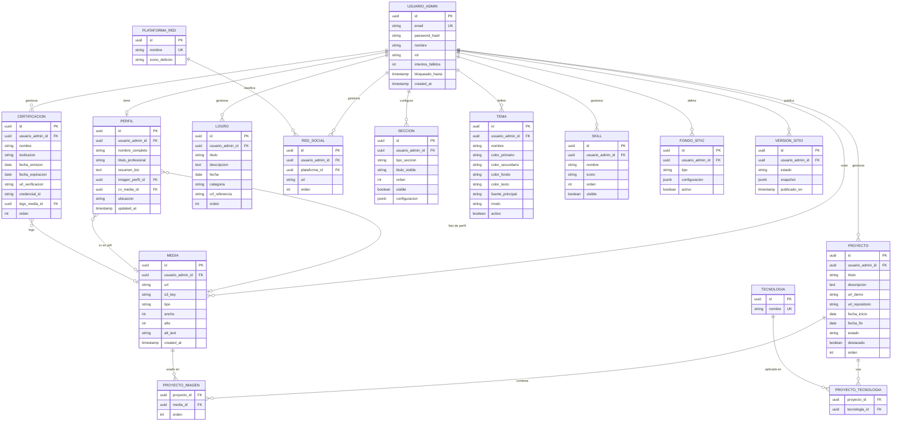

# Plan de Portafolio CV

**Documento de planificación · v2**
Autor: Oscar · Fecha: 31 ago 2026
Alcance: investigación de stack, casos de uso y modelo de datos para un portafolio/CV con panel de edición visual.

## 1. Resumen y decisiones confirmadas

Sitio público de una sola página (proyectos, certificaciones, logros, redes) respaldado por un panel privado donde tú eres el único usuario. El panel no es solo un CRUD de formularios: incluye un editor visual de arrastrar y soltar para reordenar y componer las secciones del sitio, y un selector de tema para colores y tipografía.

| Parámetro | Decisión |
|---|---|
| Editor de plantillas | Visual, tipo arrastrar y soltar |
| Multimedia | Amazon S3 |
| Autenticación | Administrador único |
| Hosting (aplicación) | VPS propio |

El modelo de datos queda preparado para admitir más de un usuario administrador en el futuro (columna de rol), aunque el alcance actual de autenticación es de un solo administrador sin registro público.

## 2. Stack técnico y librerías complementarias

Base ya definida: React en el frontend, NestJS en el backend, PostgreSQL como base de datos. Debajo, las piezas complementarias necesarias para cubrir edición visual, autenticación, imágenes y despliegue, con la opción recomendada y una alternativa viable en cada capa.

### Editor visual (drag-and-drop)

| Opción | Rol | Justificación |
|---|---|---|
| **Recomendada:** Puck | Motor del editor visual de secciones | Pensado exactamente para este caso: un editor visual embebido dentro de tu propia app React, con un modelo de contenido en JSON (fácil de guardar en Postgres) y componentes que tú mismo restringes, lo que mantiene el resultado sobrio en vez de caótico. |
| Craft.js | Alternativa para un editor a medida | Framework de más bajo nivel para construir editores drag-and-drop propios; da más control pero implica construir más piezas desde cero. |
| GrapesJS | Alternativa "todo incluido" | Builder visual más completo y maduro, pero orientado a HTML libre; cuesta más trabajo mantenerlo dentro de una identidad visual sobria y consistente. |

### Acceso a base de datos (ORM)

| Opción | Rol | Justificación |
|---|---|---|
| **Recomendada:** Prisma | ORM y migraciones sobre PostgreSQL | Esquema declarativo, migraciones versionadas y tipado end-to-end con TypeScript; buen ajuste para un proyecto que crecerá de forma incremental. |
| TypeORM | Alternativa | Integración histórica más directa con NestJS (decoradores de entidades), útil si prefieres el estilo Active Record/Data Mapper nativo del framework. |

### Autenticación del panel

| Opción | Rol | Justificación |
|---|---|---|
| **Recomendada:** @nestjs/passport + passport-jwt | Login del administrador y protección de rutas | Estándar de facto en NestJS; tokens de acceso de corta duración + refresh token, sin endpoint de registro público. Contraseña con bcrypt/argon2. |
| Guards de rol nativos de NestJS | Autorización | Preparan el sistema para distinguir roles si algún día se suma un segundo usuario, sin sobre-construir ahora. |

### Imágenes y archivos multimedia (AWS S3)

| Opción | Rol | Justificación |
|---|---|---|
| **Recomendada:** AWS S3 + `@aws-sdk/client-s3` + multer-s3 | Almacenamiento y subida de imágenes/archivos | Ya definido como proveedor de almacenamiento; el SDK oficial de AWS junto con multer-s3 sube el archivo directo al bucket desde NestJS, sin pasar por disco local. |
| sharp / multer-sharp-s3 | Procesamiento de imágenes antes de subir | A diferencia de un servicio como Cloudinary, S3 no genera miniaturas ni optimiza automáticamente; sharp (o el paquete combinado multer-sharp-s3) genera las variantes necesarias (miniatura, tamaño de galería) antes de guardarlas en el bucket. |
| Amazon CloudFront *(opcional)* | CDN delante del bucket | S3 por sí solo sirve el archivo desde su región; CloudFront agrega una capa de caché cercana al visitante cuando el tráfico lo amerite, sin cambiar el flujo de subida. |

### Interfaz visual y estilos (look sobrio y editable)

| Opción | Rol | Justificación |
|---|---|---|
| **Recomendada:** Tailwind CSS + shadcn/ui | Sistema visual base y componentes del panel | Los componentes se copian a tu proyecto (no son una caja negra), y el tema se controla con variables CSS, lo que mapea directo con el requisito de "poner colores a tu gusto". |
| Mantine | Alternativa | Librería de componentes más completa "de fábrica" (date pickers, notificaciones, etc.), a cambio de menos control fino sobre el detalle visual. |

### Estado, formularios y contenido enriquecido

| Opción | Rol | Justificación |
|---|---|---|
| TanStack Query | Cache de datos del servidor en el frontend | Sincroniza el panel admin con la API sin escribir lógica de cache manual. |
| Zustand | Estado local del editor visual | Estado ligero para la sesión de edición (bloque seleccionado, orden en curso) antes de guardar. |
| React Hook Form + Zod | Formularios y validación | Mismo esquema de validación reutilizable en frontend y como referencia para los DTO de NestJS. |
| Tiptap | Editor de texto enriquecido | Para campos largos como la biografía o la descripción de un proyecto, con salida en JSON/HTML controlado. **Decidido, todavía no implementado** (revisado en Fase 3.1, 2 sept 2026): los campos largos existentes (p. ej. `resumen_bio` del perfil) siguen usando `<Textarea>` plano de shadcn. No asumir que ya está integrado. |

### Pruebas y calidad

| Opción | Rol | Justificación |
|---|---|---|
| Jest + Supertest | Pruebas de backend | Incluidas por defecto en NestJS; cubren servicios y endpoints. |
| Vitest + React Testing Library | Pruebas de frontend | Pruebas de componentes y formularios del panel. |
| Playwright | Pruebas end-to-end | Cubre flujos completos: iniciar sesión, crear un proyecto, publicar cambios. |

### Infraestructura y despliegue (VPS propio)

| Opción | Rol | Justificación |
|---|---|---|
| **Recomendada:** Docker + Dokploy o Coolify | Empaquetado y despliegue en el VPS | Contenerizan frontend, backend y Postgres; la capa Dokploy/Coolify agrega HTTPS automático, variables de entorno y despliegues sin downtime sobre tu propio VPS, sin perder el control de "VPS propio". |
| Nginx + PM2 + Certbot | Alternativa manual | Ruta más tradicional y con más piezas que mantener a mano, útil si prefieres control total sin una capa intermedia. |
| GitHub Actions | Integración continua | Lint, pruebas y build en cada cambio antes de disparar el despliegue. |

### Control de versiones y automatización

| Opción | Rol | Justificación |
|---|---|---|
| **Recomendada:** GitHub + rama por historia + Pull Request | Flujo de versionado | El proyecto nunca se sube completo de una sola vez: cada Pull Request corresponde a una historia/caso de uso acotado, dando puntos de control claros en vez de un commit gigante difícil de revisar o revertir. |
| Husky + lint-staged | Validación antes de cada push (local) | Bloquea el push si el lint, el build o las pruebas fallan, antes de que el problema llegue a GitHub. |
| Conventional Commits | Formato de mensajes de commit | Deja trazabilidad de qué caso de uso (UC-XX) resolvió cada cambio y facilita armar un changelog por sprint. |

## 3. Casos de uso, criterios y parámetros

Dos actores: el **Administrador** (tú, usuario único autenticado) y el **Visitante** (público, sin autenticación). Cada caso de uso indica los campos/parámetros que maneja y el criterio que define cuándo se considera cumplido.

### Actor: Administrador

| ID | Caso de uso | Parámetros / campos clave | Criterio de aceptación |
|---|---|---|---|
| UC-01 | Iniciar sesión | email, contraseña | Con credenciales válidas se emite un token de sesión; tras 3 intentos fallidos se aplica bloqueo temporal. |
| UC-02 | Gestionar perfil personal | nombre completo, título profesional, resumen/bio, foto de perfil, CV en PDF, ubicación | Los cambios guardados aparecen reflejados en la sección "Sobre mí" del sitio publicado. |
| UC-03 | Gestionar proyectos | título, descripción, tecnologías, URLs (demo/repositorio), fechas, estado (en_progreso/finalizado/pausado), imágenes, orden, destacado | Un proyecto creado, editado o eliminado se refleja en la lista de proyectos respetando el orden definido. |
| UC-04 | Gestionar certificaciones | nombre, institución, fecha de emisión/expiración, URL de verificación, logo | Las certificaciones se listan ordenadas por fecha u orden manual, con enlace de verificación funcional. |
| UC-05 | Gestionar logros y reconocimientos | título, descripción, fecha, categoría, referencia | Un logro nuevo aparece en la sección correspondiente sin necesidad de despliegue de código. |
| UC-06 | Gestionar enlaces de redes | plataforma (LinkedIn, GitHub, etc.), URL, orden | Cada enlace abre la red social correcta y respeta el orden e ícono configurado. |
| UC-07 | Editar estructura visual (drag-and-drop) | tipo de sección, orden, visibilidad, configuración del bloque | Al reordenar o mostrar/ocultar una sección en el editor, el cambio se ve igual en la vista previa y, tras publicar, en el sitio en vivo. |
| UC-08 | Personalizar tema visual | color primario/secundario/fondo/texto, tipografía, modo claro/oscuro | Un tema guardado y marcado como activo se aplica de inmediato a la vista previa del sitio. El sitio publicado tiene modo oscuro real (paleta derivada automáticamente de los 4 colores del tema, no solo el `modo` como etiqueta): por defecto sigue la preferencia del sistema del visitante, con un toggle manual que la pisa; dentro del editor visual, alternar el modo oscuro del panel cambia el lienzo a la misma paleta oscura que vería un visitante, para que el editor siga siendo fiel a lo publicado. |
| UC-09 | Gestionar biblioteca multimedia | archivo, texto alternativo, tipo | Toda imagen usada en el sitio proviene de la biblioteca y puede reemplazarse sin romper la referencia en proyectos/certificaciones. |
| UC-10 | Previsualizar cambios (borrador) | snapshot de la configuración actual | Es posible ver el sitio con los cambios aplicados antes de que sean visibles públicamente. |
| UC-11 | Publicar o revertir una versión | estado (borrador/publicado), fecha de publicación | Publicar reemplaza la versión visible al público; revertir restaura la última versión publicada anterior. |
| UC-15 | Configurar fondo animado del sitio | tipo (sólido/degradado animado/aurora animada/partículas/cuadrícula animada/ondas/malla difusa/líneas diagonales), configuración (velocidad, opacidad), activo | Un fondo guardado y marcado como activo se aplica de inmediato a la vista previa y, tras publicar, al sitio en vivo; solo un fondo puede estar activo a la vez. |
| UC-16 | Gestionar catálogo de skills | nombre, ícono, orden, visible | Un skill creado, editado, reordenado u ocultado se refleja en el carrusel de skills del sitio publicado tras publicar. |
| UC-17 | Organizar secciones en columnas | distribución (1-1, 1-2, 2-1, 1-1-1), alineación vertical, espaciado, bloques anidados por columna | Un contenedor "Columnas" guardado con bloques distintos en cada columna se ve igual en el lienzo del editor, en la vista previa y, tras publicar, en el sitio en vivo; no admite anidar `hero` ni otro contenedor "Columnas" dentro de sí mismo. |
| UC-18 | Gestionar galería de fotos (bloque) | fotos (referencia a media, título opcional), disposición (carousel/grid), columnas del grid | Un bloque "Galería" guardado con fotos ordenadas se ve igual en el lienzo, la vista previa y el sitio publicado; al hacer click en una foto se abre una vista ampliada (lightbox) navegable entre todas las fotos, sin salir de la página. |

### Actor: Visitante

| ID | Caso de uso | Parámetros / campos clave | Criterio de aceptación |
|---|---|---|---|
| UC-12 | Ver el sitio publicado | última versión publicada | El contenido, orden de secciones y tema mostrados corresponden siempre a la última versión publicada, nunca a un borrador. |
| UC-13 | Ver detalle de un proyecto, certificación o logro | identificador del elemento | Cada proyecto/certificación/logro es accesible individualmente con toda su información e imágenes, desde un modal al hacer click en la home o desde un link directo compartible (`/proyecto/:id`, `/certificacion/:id`, `/logro/:id`). |
| UC-14 | Acceder a redes y descargar el CV | enlaces de redes, archivo de CV | Los enlaces y la descarga del CV funcionan sin requerir autenticación. |

## 4. Modelo de datos y diagrama ER

El esquema separa contenido (proyectos, certificaciones, logros), catálogos reutilizables (tecnologías, plataformas de red social), archivos (tabla de medios) y configuración visual (secciones, tema, versiones publicadas), evitando campos repetidos o cadenas de texto que deberían ser relaciones.

Dieciséis entidades: el administrador es el dueño de todo el contenido; `MEDIA`, `TECNOLOGIA` y `PLATAFORMA_RED` son catálogos compartidos en vez de campos de texto libre repetidos; `SECCION`, `TEMA`, `FONDO_SITIO` y `VERSION_SITIO` sostienen el editor visual y la publicación por versiones. `SKILL` sigue el mismo patrón que `LOGRO`: contenido propio del administrador (no un catálogo compartido) — a diferencia de `TECNOLOGIA`, que solo clasifica proyectos, `SKILL` es lo que se muestra en el carrusel de habilidades del sitio público, así que no tendría sentido reutilizar aquel catálogo para este propósito distinto. `FONDO_SITIO` sigue el mismo patrón de "configuración visual exclusiva" que `TEMA`, pero es deliberadamente independiente de él: `TEMA` solo maneja color y tipografía, `FONDO_SITIO` maneja el fondo animado del landing.

`USUARIO_ADMIN.intentos_fallidos` (int, default 0) y `USUARIO_ADMIN.bloqueado_hasta` (timestamp, nullable) se agregan porque el criterio de aceptación de UC-01 exige bloqueo temporal tras 3 intentos fallidos de login, y el esquema original no tenía dónde contar esos intentos ni hasta cuándo dura el bloqueo.

### Por qué queda normalizado (hasta 3FN)

- **1FN:** todo atributo es atómico: no hay campos como "tecnologias: React, NestJS" en una sola celda; eso vive en `PROYECTO_TECNOLOGIA`, una fila por tecnología usada.
- **2FN:** en las tablas de unión (`PROYECTO_TECNOLOGIA`, `PROYECTO_IMAGEN`) los atributos no clave dependen de la combinación completa de la llave compuesta, no de una sola mitad.
- **3FN:** no hay dependencias transitivas: el nombre de una plataforma de red social o de una tecnología vive una sola vez en su catálogo (`PLATAFORMA_RED`, `TECNOLOGIA`), no repetido en cada fila que la referencia.

Tres excepciones deliberadas, todas justificadas por el propio requisito de edición visual: `SECCION.configuracion`, `VERSION_SITIO.snapshot` y `FONDO_SITIO.configuracion` usan `JSONB` porque el contenido de un bloque del editor (o una foto completa del sitio para poder revertirla, o los parámetros de un fondo animado) tiene forma variable por diseño; forzarlo a columnas fijas obligaría a rediseñar el esquema cada vez que agregues un tipo de bloque o de fondo nuevo. `FONDO_SITIO.configuracion` en particular guarda solo `velocidad` y `opacidad`, los dos parámetros que comparten los cinco tipos de fondo (sólido, degradado animado, aurora animada, partículas, cuadrícula animada); columnas fijas por tipo obligarían a alterar el esquema cada vez que se agregue un tipo de fondo nuevo.

`SECCION.configuracion` como `JSONB` tiene además una segunda ventaja que se explota recién en UC-17 (layouts en columnas, Fase 3.3 del rediseño del editor): un bloque `columnas` es una `SECCION` más, con `tipo_seccion = 'columnas'`, cuya `configuracion` guarda no solo `distribucion`/`alineacion_vertical`/`espaciado` sino también los bloques anidados de cada columna, con la misma forma que tendría cada uno como fila propia (mismo DTO por tipo, validado igual). **Decisión explícita: no se agrega ninguna entidad ni columna nueva para esto** — la alternativa evaluada (una auto-relación `SECCION.seccion_padre_id`) se descartó porque exige migración, cambia la lógica de listar/reordenar secciones, y su único beneficio real (un id de fila estable por cada bloque anidado) no compensa la complejidad para un proyecto de un solo administrador sin enlaces directos a una sección individual. Consecuencia aceptada de esta decisión: anidar una sección ya existente dentro de un contenedor "Columnas" borra su fila y su contenido pasa a vivir en el JSON del contenedor; sacarla de nuevo a nivel superior crea una fila nueva (no recupera el `id` original). Un contenedor "Columnas" no admite anidar `hero` (la portada ocupa todo el ancho por diseño) ni otro contenedor "Columnas" (evita anidamiento sin límite en el resolver de media, el snapshot y el renderer) — restricción de un solo nivel, reforzada en el DTO de configuración, no solo en la UI.

El mismo criterio de `SECCION.configuracion` como `JSONB` cubre UC-18 (bloque "Galería", Fase 4.5 del rediseño): `tipo_seccion = 'galeria'` guarda un array de fotos (`media_id` + título opcional) más `disposicion`/`columnas_grid`. **Decisión explícita: no se usa el patrón `PROYECTO_IMAGEN`** (relación N:N con su propia tabla) para esto — a diferencia de las imágenes de un proyecto, que son datos propios de la entidad `PROYECTO` con sentido fuera del editor visual (se listan también en `GET /admin/proyectos/:id`), las fotos de una galería son una forma variable propia de un bloque del editor, exactamente el tipo de caso que la excepción JSONB ya cubre — igual que los bloques anidados de `columnas`. Sin migración de tabla.

> **Regla de negocio a aplicar en la aplicación (no solo en el esquema):** solo un registro de `TEMA` por administrador puede tener `activo = true` a la vez; conviene reforzarlo con un índice único parcial en PostgreSQL además de la validación en NestJS.

> **Regla de negocio a aplicar en la aplicación (no solo en el esquema):** solo un registro de `FONDO_SITIO` por administrador puede tener `activo = true` a la vez; mismo mecanismo que `TEMA` (índice único parcial en PostgreSQL + validación en NestJS).

> **Regla de negocio a aplicar en la aplicación (no solo en el esquema):** `SKILL.nombre` debe ser único por administrador sin distinguir mayúsculas/minúsculas — no pueden coexistir, por ejemplo, "Java" y "java" en el mismo carrusel de skills (Fase 3.2 del rediseño del editor, hallazgo de "skills duplicados"). Un `@@unique` declarativo de Prisma no sirve aquí porque compara de forma sensible a mayúsculas/minúsculas; se refuerza con un índice único funcional en PostgreSQL sobre `(usuario_admin_id, lower(nombre))`, mismo mecanismo manual que `tema_admin_activo_unico` y `fondo_sitio_admin_activo_unico`, más la validación correspondiente en SkillsService.

## 5. Despliegue y operación en el VPS

Consideraciones para que el VPS propio quede simple de mantener siendo tú el único administrador del sistema.

- **Contenedores:** un contenedor para el frontend, uno para la API NestJS y uno para PostgreSQL (o Postgres administrado aparte con backups automáticos), orquestados con Docker Compose.
- **Capa de despliegue:** Dokploy o Coolify sobre el VPS para HTTPS automático, variables de entorno y despliegues disparados por cada push a la rama principal.
- **Respaldo de base de datos:** tarea programada de `pg_dump` con copia en un bucket S3 (el mismo usado para medios u otro dedicado a backups).
- **Variables sensibles:** credenciales de AWS (idealmente un usuario/rol IAM con permisos acotados solo al bucket), secreto JWT y credenciales de Postgres fuera del repositorio, gestionadas como variables de entorno del VPS.

## 6. Control de versiones y flujo de trabajo (Git + Scrum)

El proyecto se sube a GitHub de forma escalonada, nunca completo de una sola vez, y avanza en sprints cortos con un punto de control tuyo al final de cada uno. Un subagente dedicado, `release-manager`, decide cuándo un cambio está listo para commitear o pushear, y arma el resumen de cierre de cada sprint.

### Estrategia de ramas

- `main` siempre queda desplegable: nunca recibe push directo, solo cambios vía Pull Request.
- Cada historia (normalmente, un caso de uso de la sección 3) vive en su propia rama, por ejemplo `feature/uc-03-proyectos`.
- Cerrar una historia = abrir un Pull Request hacia `main`, aunque trabajes solo: da un punto de revisión concreto en vez de perder el cambio en una rama larga.
- Al cerrar un sprint completo se etiqueta la versión sobre `main` (`v0.1.0`, `v0.2.0`, …).

### Niveles de criticidad (qué tan seguido se empuja)

| Nivel | Ejemplos | Cómo se maneja |
|---|---|---|
| Bajo | Ajustes de estilos, textos, configuración menor | Se acumula en commits pequeños dentro de la rama de la historia en curso; no requiere Pull Request inmediato. |
| Moderado | Un caso de uso completo y probado (ej. UC-04 Certificaciones) | Se empuja en su propia rama y se abre Pull Request hacia `main`; marca el cierre de una historia dentro del sprint. |
| Crítico | Cambios al esquema de datos, autenticación, o algo que toca varios módulos a la vez | Nunca merge directo: exige revisión de `code-reviewer`, pruebas completas y tu aprobación explícita antes de mergear. |

### Validación antes de cada push

Antes de que un cambio salga de tu máquina hacia GitHub, build, lint y pruebas deben pasar en local (vía Husky) y se repiten de forma independiente en GitHub Actions al abrir el Pull Request. `release-manager` corre esta verificación y bloquea el push si algo falla, en vez de descubrir el problema después de que ya está en el repositorio.

Si en algún momento corres dos subagentes de código a la vez (por ejemplo `backend-nestjs` y `frontend-react` trabajando en paralelo), agrégales `isolation: worktree` en su frontmatter: cada uno trabaja sobre su propia copia temporal del repositorio en vez de sobre los mismos archivos, así sus cambios no se superponen antes de integrarlos.

### Sprints sugeridos

| Sprint | Alcance | Punto de control (tu visto bueno) |
|---|---|---|
| 0 — Cimientos | Monorepo, esquema Prisma inicial, autenticación (UC-01) | Puedes iniciar sesión como administrador en local. |
| 1 — Contenido base (API) | UC-02 a UC-06: perfil, proyectos, certificaciones, logros, redes, sin interfaz aún | La API responde y está probada (Jest/Supertest). |
| 2 — Panel de administración | Pantallas CRUD para todo lo del sprint 1 | Puedes cargar tu CV real desde el panel. |
| 3 — Editor visual y tema | UC-07 a UC-09: secciones drag-and-drop, colores/tipografía, biblioteca de medios en S3 | Puedes reordenar secciones y cambiar el tema desde el panel. |
| 4 — Publicación y sitio público | UC-10 a UC-14: borrador/publicar y sitio visible | El sitio público muestra tu información real, con enlaces y CV descargable. |
| 5 — Despliegue | Docker + Dokploy/Coolify en el VPS, backups a S3 | El sitio es accesible desde tu dominio. |

Cada sprint cierra con un resumen de `release-manager`: qué UC quedaron terminados y probados, qué quedó pendiente, y qué decisión necesita tu aprobación antes de arrancar el siguiente. El sprint no avanza hasta que des el visto bueno o pidas ajustes.

## 7. Siguientes pasos sugeridos

1. Confirmar el detalle de `SECCION.configuracion`: qué tipos de bloque existirán al inicio (hero, sobre mí, proyectos, certificaciones, logros, contacto) y qué parámetros tiene cada uno.
2. Definir el catálogo inicial de `TECNOLOGIA` y `PLATAFORMA_RED` con los valores que usarás desde el día uno.
3. Definir la política y estructura de carpetas del bucket S3 (por ejemplo, `perfil/`, `proyectos/`, `certificaciones/`, `backups/`) y sus permisos.
4. Crear el repositorio en GitHub, activar protección de la rama `main` (exigir Pull Request + checks de GitHub Actions) e instalar Husky + lint-staged en el monorepo.
5. Diseñar los endpoints de la API (por caso de uso) antes de tocar código, siguiendo la tabla de casos de uso como checklist.
6. Recién entonces, iniciar la implementación siguiendo los sprints de la sección 6: primero el modelo de datos en Prisma, luego autenticación, luego CRUD de contenido y al final el editor visual.

## Fuentes consultadas

- [Puck — Top 5 Drag-and-Drop Libraries for React](https://puckeditor.com/blog/top-5-drag-and-drop-libraries-for-react)
- [Bytebase — Prisma vs TypeORM](https://www.bytebase.com/blog/prisma-vs-typeorm/)
- [Prisma — Enterprise-ready database for NestJS apps](https://www.prisma.io/nestjs)
- [Documentación oficial de NestJS — Passport](https://docs.nestjs.com/recipes/passport)
- [DesignRevision — Mantine vs shadcn/ui](https://designrevision.com/compare/mantine-vs-shadcn)
- [Introserv — Dokploy vs Coolify (2026)](https://introserv.com/blog/dokploy-vs-coolify-complete-comparison-of-the-best-self-hosted-paas-platforms-for-vps-and-dedicated-servers-2026/)
- [Nestbolt — NestJS File Uploads con miniaturas y S3 (2026)](https://nestbolt.io/blog/file-uploads-nestjs-medialibrary)
- [npm — multer-sharp-s3](https://www.npmjs.com/package/multer-sharp-s3)
